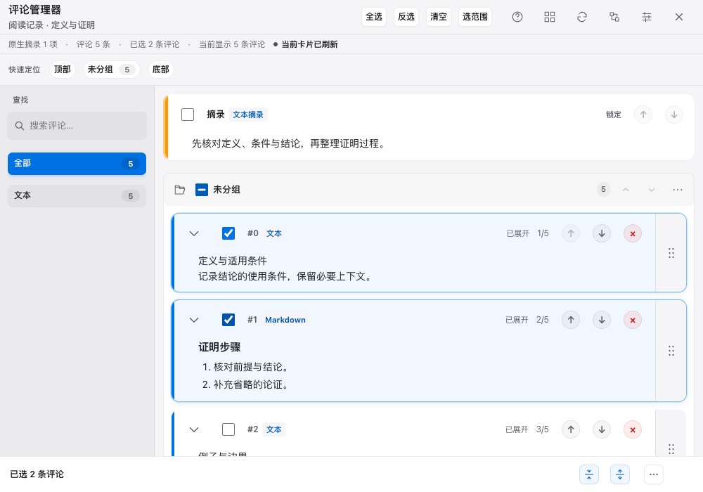

# MN Comment Manager

在 MarginNote 中集中查看与整理卡片评论，完成搜索、排序、合并、提取和多卡片工作流处理。

[下载正式版](https://github.com/xkwxdyy/MNCommentManager/releases/latest) · [入门视频](https://www.bilibili.com/video/BV1rpEA6fEau/) · [反馈问题](https://github.com/xkwxdyy/MNCommentManager/issues)


## 界面预览

<picture>
  <source media="(max-width: 600px) and (prefers-color-scheme: dark)" srcset="./assets/readme/comment-panel-mobile-dark.png">
  <source media="(max-width: 600px)" srcset="./assets/readme/comment-panel-mobile-light.png">
  <source media="(prefers-color-scheme: dark)" srcset="./assets/readme/comment-panel-dark.png">
  
</picture>

浏览器演示使用当前前端与示例数据，不连接真实 MarginNote 资料库；截图不代表原生宿主或移动设备已完成验收。

## 常用操作

### 阅读与定位

评论列表保留类型、位置和链接信息，支持全文搜索与类型筛选。文本、图片、链接、HTML 和音频等内容可以分别查看。支持折叠的宿主可将评论收起为摘要或缩略图，搜索仍会检查完整正文。

### 选择与整理

评论支持单选、多选和连续范围选择。所选内容可以上移、下移或移动到指定位置，也可以复制文本或图片、跳转到关联卡片、编辑支持的文本、合并为 Markdown 评论、提取到子卡片或删除。纯卡片链接支持通过长按选择双向删除。

卡片旁的快捷控件适合调整顺序：按内容选择评论后，点按箭头逐项移动，长按箭头连续预览，拖动中间控件跨位置调整。预览会展示相邻评论，松开后提交；评论列表发生变化时需要重新选择。

### 快速追加评论

轻量输入窗口支持原生文本与 Markdown 评论。Enter 提交，Shift+Enter 换行；最近使用的 Markdown 模式会保留。未提交草稿仅保存在当前窗口会话中，重启应用后不保留；保存结果尚未确认时，原提交内容会保留以便核对。

评论管理和添加评论按钮可分别配置点按与长按动作。

### 重复处理多张卡片

评论工作流可以保存操作步骤、调整顺序，并应用到多张卡片。每张卡片分别执行步骤，评论不会因批处理自动合并到另一张卡片。工作流定义以 JSON 保存在 MarginNote 文档目录中。

## 安装与快速上手

最低宿主版本为 **MarginNote 4.2.3**，运行依赖为 **MN Utils**。

1. 安装并启用 MN Utils。
2. 从[正式发布页](https://github.com/xkwxdyy/MNCommentManager/releases/latest)下载 `.mnaddon` 安装包，并导入 MarginNote。2026-11-02 核实的正式版本为 [v0.1.37](https://github.com/xkwxdyy/MNCommentManager/releases/tag/v0.1.37)，安装包为 `mn-comment-manager-v0.1.37.mnaddon`。
3. 启用评论管理器，选择一张卡片，再通过评论管理入口打开面板。
4. 先尝试搜索和查看评论，再按需要选择评论并进行整理。

MN Utils 是必需依赖；评论管理器不内置 `MNUtil` 或 `MNNote` 的副本。

[入门视频](https://www.bilibili.com/video/BV1rpEA6fEau/)介绍基本使用方式。[项目介绍视频](https://www.bilibili.com/video/BV1vHnE6YEhe/)提供功能概览。面板顶栏的问号图标也可以打开视频选择：优先使用已启用的 MNBrowser，其次使用可用学习集的研究浏览器，最后使用系统浏览器。

## 兼容性与使用边界

- **评论折叠**按宿主能力启用。缺少相关接口时，折叠功能会提示不可用，其余功能仍可使用。
- **MN5 原生卡片菜单**属于内测宿主的可选接入方式。MN Utils 和评论管理器需要全局启用，并获得当前场景的运行许可；场景模板可保存许可和命令，无需额外放置工具栏按钮。
- **已有动态入口**保留自定义动作；原生菜单覆盖范围无法确认时，动态入口继续保留。接入步骤与重复入口规则见[场景模板说明](https://github.com/xkwxdyy/MNCommentManager/blob/main/README.native-card-menu.md)。
- **MN5 验收范围**目前为 Mac 卡片菜单。旧宿主、iPad、iPhone、文档摘录菜单、键盘与 VoiceOver 的完整验收仍待完成。当前源码中的功能不一定包含在既有同版本安装包中。
- **删除、提取与批量处理**会改变卡片内容。首次使用前，建议先在测试卡片中确认选择范围与处理结果。

<details>
<summary>评论折叠与撤销规则</summary>

### 折叠后的选择行为

折叠按钮位于每条评论复选框左侧。顶栏继续负责选择与全局命令，底部折叠和展开操作独立于滚动列表。点击已选评论的折叠按钮，会将该条评论的目标状态应用到全部所选评论，包括当前隐藏的所选评论；点击未选评论时，仅处理该条评论。写入成功后保留选择，原生摘录不参与评论折叠。

折叠切换会保持被点击评论的标题可见。底部“更多”菜单提供移动、处理、删除及包含隐藏评论的全选操作。

### 批量折叠与一致性

多卡片编辑器或工作流可以使用 `foldSelectedComments` 和 `unfoldSelectedComments`。每张卡片重新读取列表版本；每次宿主调用最多处理 200 条评论，超过上限会拒绝执行，避免拆分为部分提交。

插件转换从零开始的评论下标，核对预期版本，再由宿主负责保存、回滚、刷新与撤销。写入失败后重新读取列表，过期选择会在再次写入前清除。

### 工作流的撤销分组

不含折叠动作的工作流使用同一撤销组。包含折叠动作时，折叠事务由宿主独立管理，其余连续动作使用各自共享的撤销组。

</details>

<details>
<summary>开发、扩展与发布配置</summary>

### 本地开发

项目固定使用 pnpm 10.34.7。安装依赖后可启动开发模式或构建安装包。

```bash
pnpm install
pnpm dev
pnpm build
```

`pnpm dev` 同时启动网页开发服务和插件实时部署监听，运行前需要确认本地 MarginNote 开发环境。正式构建生成网页资源与 `.mnaddon` 安装包，文件名中的版本取自项目清单。

### 代码位置

- `src/main.js` 与 `src/MNCommentManagerAddon.js`：JavaScriptCore 入口、生命周期与工具栏命令。
- `src/WebPanelController.js` 与 `src/WebBridgeCommands.js`：浮动面板及原生通信。
- `src/CommentData.js` 与 `src/CommentMutations.js`：评论读取、能力检测与内容修改。
- `src/CommentWorkflowStore.js`、`src/CommentWorkflowRegistry.js`、`src/CommentWorkflowRunner.js` 与 `src/CommentWorkflowMenu.js`：工作流存储、动作注册、逐卡执行及菜单。
- `web/`：React 与 Vite 前端源码。
- `src/update-fallback/`：更新清单和结构化更新日志的备用数据。

独立 Patch 插件可以扩展动作目录；版本化注册接口与示例位于 `patches/README.md`。

### 更新元数据

安装包上传至正式分发目录后，使用对应文件的下载地址和标识生成清单。以下参数需要替换为当前上传结果。

```bash
pnpm manifest -- \
  --download-url "<当前安装包的下载地址>" \
  --file-id "<当前安装包的文件标识>"
```

清单写入 `debug/123pan/mncommentmanager.json`，备用清单位于 `src/update-fallback/mncommentmanager.json`。`changelogUrl` 指向 MNUtils 使用的[结构化更新日志](https://api.xkwxdyy.cn/update/mncommentmanager_changelog.json)。发布前需要同步 `src/update-fallback/mncommentmanager_changelog.json` 与对应版本的实际变化。

插件标识：`marginnote.extension.mncommentmanager`。

</details>

## 反馈与问题跟踪

请在 [GitHub Issues](https://github.com/xkwxdyy/MNCommentManager/issues) 中说明 MarginNote 版本、设备、插件版本、复现步骤及预期结果，截图应避开私有笔记内容。仓库仅维护评论管理器，问题标题无需添加插件前缀。
